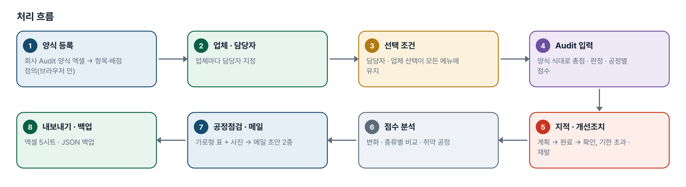
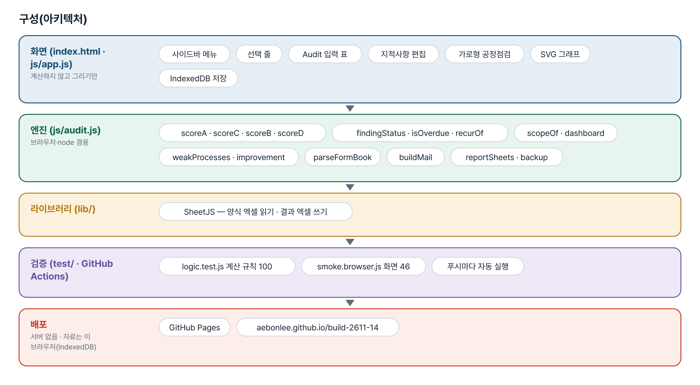
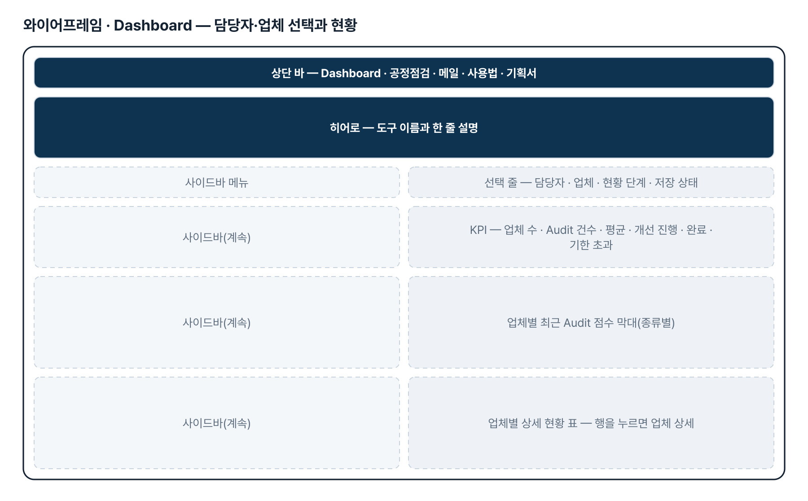
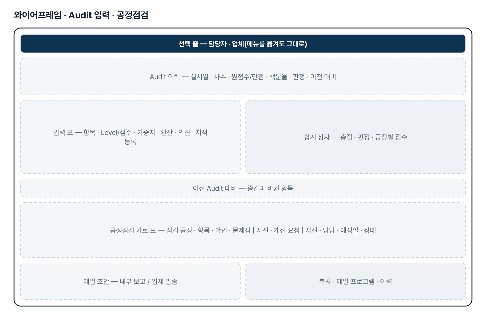
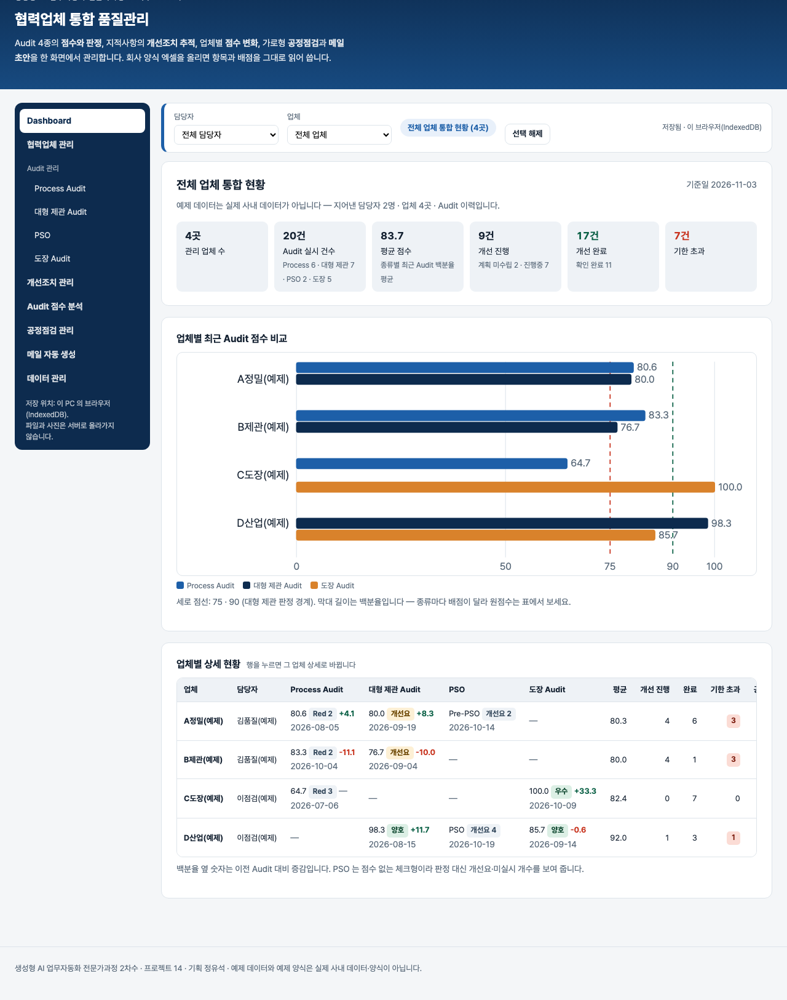

# 협력업체 통합 품질관리 — 프로젝트 기획서 v1.0

- 기획: 정유석 · 작성일 2026-11-03 · 생성형 AI 업무자동화 전문가과정 · 2차수 프로젝트 14
- 바로 쓰기: https://build-2611-14.jobability.co.kr/
- 워드 판: `docs/기획서/build-2611-14_정유석_협력업체통합품질관리_기획서_v1.0.docx`

## 개요

담당자·업체를 한 번 고르면 모든 메뉴가 그 조건을 따르는 화면에서 협력업체 Audit 4종의 점수·판정, 지적사항 개선조치 추적, 업체별 점수 변화, 가로형 공정점검(사진 첨부), 내부 보고·업체 발송 메일 초안을 관리하는 브라우저 도구입니다.

### 배경 · 현재 업무
- 제관품질파트는 Process · 대형 제관 · PSO · 도장 4종 Audit 를 Audit 마다 다른 엑셀 양식으로 관리합니다.
- 그래서 업체별 Audit 이력 · 지적사항 · 개선 진행상황 · 점수 변화를 한눈에 보기 어렵습니다.
- 공정점검 뒤 파트장·팀장 보고와 업체 개선 요청 메일을 매번 새로 쓰는 반복 업무가 있습니다.

### 목표
- 담당자·업체 선택 하나로 전체 · 담당자 · 업체 상세 현황을 모든 메뉴에서 같은 조건으로 봅니다.
- 회사 양식 엑셀의 항목·배점을 그대로 읽어 Audit 4종 점수와 판정을 양식의 식대로 계산합니다.
- 지적사항을 품질 담당자 확인까지 추적하고 기한 초과 · 재발 · 반복 지적을 자동으로 표시합니다.
- 가로형 공정점검(사진 첨부) 결과로 내부 보고·업체 발송 메일 초안을 만듭니다.

## 요구사항과 구현

| 기획서 요구 | 구현 |
|---|---|
| 대시보드 · 담당자/업체 선택 · 전 메뉴 유지 | 선택 줄을 모든 메뉴 위에 두고 localStorage 에 유지, 전체 · 담당자 · 업체 상세 3단 |
| 업체 수 · Audit 건수 · 평균 · 개선 현황 · 비교 그래프 · 상세 표 | KPI 6개 · 업체별 최근 점수 막대 · 업체 표(행을 누르면 업체 상세) |
| Audit 4종 HTML 구현 · 기존 항목·배점 유지 | 회사 양식 엑셀을 올려 머리글 낱말로 항목·배점·가중치·CTQ·선택지를 읽음(열 직접 고르기 가능) |
| 점수 입력 · 총점 자동 계산 · 저장 · 이력 · 이전 비교 | 양식의 엑셀 식 그대로 · 판정 · 공정별 점수 · 차수 자동 · 이전 대비 증감과 바뀐 항목 |
| 지적사항 · 4단계 상태 · 기한 초과 · 조치 이력 · 반복 지적 | 계획 미수립 → 개선 진행중 → 개선 완료 → 확인 완료, 기한 초과 · 재발 자동, 반복 지적 표 |
| 점수 변화 · 종류별 비교 · 개선 효과 · 취약 공정 · 원점수/백분율 | 선 그래프 · 종류별 비교 표 · 첫→최근 변화 · 공정별 평균, 원점수와 백분율을 따로 표시 |
| 가로형 공정점검 · 문제점/개선 사진 여러 장 · 진행상태 | 기획서 열 순서의 가로 표, 사진은 긴 변 1280px 로 줄여 IndexedDB 저장, 설명 입력 |
| 메일 2종 자동 생성 · 수정 · 복사 · 이력 · 입력 안 된 정보 생성 금지 | 내부 보고 6절 · 업체 발송(요청형), 빠진 정보는 「(입력 없음)」과 경고, 복사 · mailto · 이력 |

## 주요 기능

- **Dashboard** — 선택 조건에 따라 전체 · 담당자 · 업체 상세 현황으로 바뀝니다. KPI 6개, 업체별 점수 비교 막대, 업체 표, 업체 상세에서는 점수 변화 · 미완료 개선사항 · 공정점검 이력.
- **Audit 관리 4종** — 선택한 업체로 바로 열립니다. 입력하는 대로 총점 · 판정 · 공정별 점수를 계산하고 미입력 개수를 알립니다. 이전 Audit 대비 증감과 바뀐 항목을 보여 줍니다.
- **양식 엑셀 읽기** — 회사 양식을 종류마다 올리면 항목 · 배점 · 가중치 · CTQ · 선택지 · 공정 묶음을 그대로 읽습니다. 머리글을 못 찾으면 열을 직접 고릅니다.
- **개선조치 관리** — 평가자 · 수검자 · 확인 칸을 나눈 지적사항 표. 결과 · 기한 초과 · 재발을 자동 표시하고 반복 지적을 모읍니다.
- **Audit 점수 분석** — 업체별 점수 변화, 종류별 비교, 첫→최근 개선 효과, 개선조치 완료율, 취약 공정.
- **공정점검 · 메일** — 엑셀 같은 가로 표에 문제점 · 개선 사진을 붙이고, 그 결과로 내부 보고 · 업체 발송 메일 초안을 만듭니다.
- **데이터 관리** — 엑셀 5시트 내보내기(선택 조건), 전체 백업 · 복원(JSON, 사진 포함), 선택 AI 문장 다듬기 설정.

## 처리 흐름(파이프라인)

1. **양식 등록** — 회사 Audit 양식 엑셀 → 항목·배점 정의(브라우저 안)
2. **업체 · 담당자** — 업체마다 담당자 지정
3. **선택 조건** — 담당자 · 업체 선택이 모든 메뉴에 유지
4. **Audit 입력** — 양식 식대로 총점 · 판정 · 공정별 점수
5. **지적 · 개선조치** — 계획 → 완료 → 확인, 기한 초과 · 재발
6. **점수 분석** — 변화 · 종류별 비교 · 취약 공정
7. **공정점검 · 메일** — 가로형 표 + 사진 → 메일 초안 2종
8. **내보내기 · 백업** — 엑셀 5시트 · JSON 백업

## 구성(아키텍처)

- **화면 (index.html · js/app.js)** — 사이드바 메뉴 · 선택 줄 · Audit 입력 표 · 지적사항 편집 · 가로형 공정점검 · SVG 그래프 · IndexedDB 저장
- **엔진 (js/audit.js)** — scoreA · scoreC · scoreB · scoreD · findingStatus · isOverdue · recurOf · scopeOf · dashboard · weakProcesses · improvement · parseFormBook · buildMail · reportSheets · backup
- **라이브러리 (lib/)** — SheetJS — 양식 엑셀 읽기 · 결과 엑셀 쓰기
- **검증 (test/ · GitHub Actions)** — logic.test.js 계산 규칙 100 · smoke.browser.js 화면 46 · 푸시마다 자동 실행
- **배포** — GitHub Pages · aebonlee.github.io/build-2611-14

## 화면 구성(와이어프레임)

## 규칙 · 판정 기준

- 대형 제관: 환산 = Level(0~3) × 가중치(CTQ 2 · 그 밖 1), 총점 = 환산 합 / (가중치 합 × 3) × 100, 90 이상 양호 · 75 이상 개선요 · 그 밖 불합격.
- Process: 공정별 10점 = 환산 / 유효 합계 × 10(유효 = 2 × 가중치 합 − 2 × N/A 가중치 합, 0 이면 N/A), Grade 9 이상 Green · 7 이상 Yellow · Red, 총점은 100점 환산.
- PSO: 양호 · 개선요 · 미실시 체크형(점수 없음) — 개수와 양호 비율, 상세 OK/NG/N/A 는 「제외」를 세지 않습니다.
- 도장: N/A 뺀 평가점수 합 / N/A 뺀 배점 합 × 100, 90 이상 우수 · 80 이상 양호 · 70 이상 개선 필요 · 그 밖 전면 개선 필요.
- 지적 결과: 계획일정 없음 → 계획 미수립, 완료일정 없음 → 개선 진행중, 그 밖 개선 완료, 확인일 → 확인 완료. 계획일정(없으면 완료 요청일)이 지나면 기한 초과.
- 메일 초안은 입력된 정보만 씁니다. 비어 있으면 「(입력 없음)」으로 두고 빠진 항목을 알립니다.

## 검증

- 계산 규칙 테스트 100개 · 화면 연기 테스트 46개 통과
- 엔진을 일부러 14가지로 깨뜨려 확인했습니다 — 만점 식 · 판정 경계 · N/A 처리 · 확인 완료 · 기한 초과 당일 · 재발 업체 · 공정 물려받기 · 메일 날짜 지어내기 · 선택 해제 · 선택지 0 을 바꾸면 각각 해당 테스트가 실패합니다.
- 화면도 6가지로 깨뜨려 확인했습니다 — 선택 유지 · 저장 지연 · 합계 갱신 · 메일 전환 · 사진 저장 · 내보내기 범위. 저장을 미루던 첫 판은 새로 고침 직후 마지막 Audit 를 잃어서 바로 저장하도록 고쳤습니다.
- 화면 테스트: 예제 → 대시보드 3단 → 메뉴 이동 뒤 선택 유지 → Audit 입력(100 → 83.3 · 개선요) → 지적 등록 · 기한 초과 → 새로 고침 뒤 유지 → 공정점검 사진 → 메일 2종 → 양식 엑셀 읽기 → 엑셀 · 백업 → 360px.

## 이번 판에서 하지 않는 것

- 이 PC 한 브라우저에 저장하는 시제품입니다. 여러 담당자가 함께 쓰려면 별도 서버와 데이터베이스가 필요합니다.
- 회사 양식의 서식(병합 셀 · 색 · 인쇄 모양)은 옮기지 않습니다 — 항목 · 배점 · 점수식만 씁니다.
- 메일은 직접 보내지 않고 사진을 자동 첨부하지 않습니다(복사 · 메일 프로그램 열기 · 사진 내려받기).
- 로그인 · 권한(평가자/수검자) · 사내 시스템 연동은 하지 않습니다.

## 다음 단계

- 서버 · 데이터베이스 연동(백업 JSON 의 자료 구조를 그대로 표로)
- Audit 결과를 회사 양식 모양 그대로 채운 엑셀 내보내기
- 평가자 · 수검자 화면 분리(업체가 원인분석 · 개선대책 직접 입력)
- 지적사항 요약 · 메일 다듬기 AI 보조 확대(선택)

## 버전 이력

- **v1.0** (2026-11-03) — 첫 판 — Dashboard(담당자·업체 3단) · Audit 4종 점수·판정 · 양식 엑셀 읽기 · 개선조치 추적 · 점수 분석 · 가로형 공정점검(사진) · 메일 초안 2종 · 엑셀·백업 / 기획서 워드 판·파이프라인·아키텍처·와이어프레임 추가
